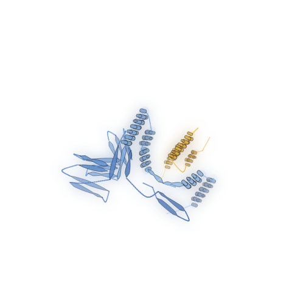

# mubind

[Project page](https://b1ro.github.io/mubind/) · [Documentation](https://b1ro.github.io/mubind/documentation.html#/) · [Presentation](https://b1ro.github.io/mubind/minibinder-presentation-audience.pdf) · [Hugging Face](https://huggingface.co/spaces/b1ro/mubind) · [Code](https://github.com/B1RO/mubind)



This repository presents a pipeline for designing minibinders for a chosen target protein, with control over length, net charge, and hydrophobicity. At its core is our generative model, trained to design amino acid sequences that meet both structural and biochemical requirements. This allows you to design minibinders with practical concerns such as solubility and aggregation in mind, alongside binding to the target.

If you’d like to learn more about this work, see the [project page](https://b1ro.github.io/mubind/) or [presentation](docs/minibinder-presentation-audience.pdf).

## Quickstart

Try the diffusion model in the [Hugging Face demo](https://b1ro-mubind.hf.space/). For the full pipeline, including seed generation and downstream evaluation, follow the setup below.

### Setup

To install mubind, use:

```bash
git clone https://github.com/B1RO/mubind.git
cd mubind
./mubind setup
```

This clones the repository, prepares the Python environment, and opens an interactive menu to download the required model weights and environments. Training data is optional and is prepared separately when you choose to train. Running the full design pipeline requires Linux, an NVIDIA GPU with at least 20 GB of VRAM, and 60 GB of free disk space.

mubind uses uv to manage Python and dependencies automatically. When run from a checkout, the `./mubind` launcher creates an isolated `.venv` folder inside it. You do not need to install Conda or uv beforehand, create or activate an environment, or install packages manually. Model environments and weights are kept in `artifacts/models/` by default, and optional training data in `artifacts/datasets/`. Saved custom locations are preserved. Small benchmark and example inputs are included under `artifacts/`; generated results stay in their own subfolders there.

<details>
<summary>Use an existing Python or Conda environment</summary>

To use an existing Python 3.10+ venv or Conda environment, run the following from the repository directory using that environment's Python.

```bash
python -m pip install -e ".[evaluation]"
python -m mubind setup
```

The `evaluation` extra includes the paper evaluation tools. Use `python -m mubind` for other commands too, such as `python -m mubind train`. uv remains a dependency used internally to prepare the separate Complexa and ESMFold2/ESMC environments.

</details>

### Generate minibinders

To generate a minibinder, use:

```bash
./mubind generate
```

Follow the prompts to select your target protein’s PDB file, choose or generate a backbone scaffold, and specify your desired binder properties for sequence redesign. For a first run, try the bundled PD-L1 example (`pdl1.pdb`). mubind will generate and rank designs for your target, saving their sequences and predicted structures in `artifacts/generations/`.

The repository also includes 11 example target PDBs, comprising ten targets from Proteina-Complexa and ubiquitin (`ubiquitin_1UBQ.pdb`). Setup places them in `artifacts/targets/`, and the target picker fills in the Proteina-Complexa targets' regions, hotspots and compatible binder lengths.

FYI, loading the models can take up a significant part of an inference run. If you plan to run many experiments, start `./mubind provider` in a separate terminal. This keeps the Complexa and folding models loaded in memory so each `./mubind generate` run can reuse them instead of starting them from scratch.

### View designs

Run `./mubind view` to explore your latest designs in 3D at `http://localhost:8000`. Select a candidate to see its binder in blue beside the target in grey.

When working over SSH, first run `ssh -N -L 8000:127.0.0.1:8000 user@server` in a separate terminal on your own computer, replacing `user@server` with your SSH destination. Then run `./mubind view` on the server and open the address locally. Keep both commands running while viewing. Use **Save HTML** to keep a copy that opens offline.

### Train the model

To train the generative model, first prepare its dataset, then open the training menu:

```bash
./mubind setup --only prostt5
./mubind train
```

The training menu lets you configure and start a new run or resume from a saved checkpoint.

## Documentation

- [CLI](docs/cli.md) covers commands, interactive menus and saved settings.
- [Generation](docs/generation.md) covers preparing targets, choosing design options and interpreting results.
- [Training](docs/training.md) covers preparing data, configuring runs and evaluating the model.
- [Evaluation](docs/evaluation.md) covers running benchmarks, interpreting metrics and comparing results with the paper.
- [Hardware requirements](docs/hardware_requirements.md) explains what each workflow needs and why.
- [Repository overview](docs/repository_overview.md) explains the code structure and how its components connect.

## Acknowledgements

The approach taken in this work builds upon OmegAMP and many others. Please see the paper for the full set of citations. We’d also like to express our gratitude to Leon Hetzel for supervising this project.
