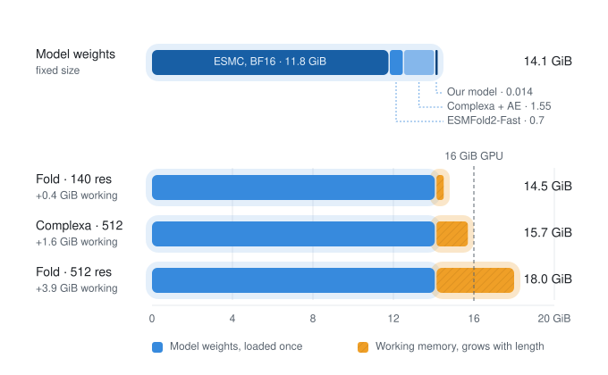
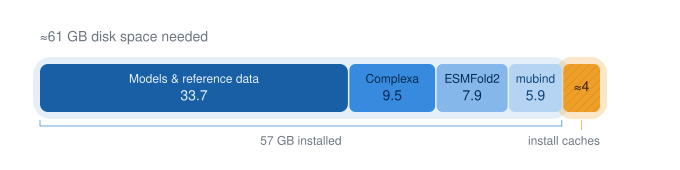

# mubind hardware requirements

## Generating minibinders

Running the full design pipeline requires the following system setup.
- A **Linux** environment.
- An NVIDIA GPU with **≥20 GB VRAM**.
- **≥60 GB free disk space** for model files, software environments and installation caches. Model downloads account for about 34 GB of this budget.

Structure prediction accounts for most GPU memory use. The folding models occupy about 13.5 GB for their weights alone, with additional memory needed to process the target and binder together. Longer targets and larger batches may need more than 20 GB VRAM. The diffusion model itself can run on CPU for standalone sequence sampling.

## Training

Training updates only the 15 MB diffusion model, so the default BF16 run at a batch size of 1,024 uses under 6 GB of VRAM on its own. However, default `full` evaluation also keeps the 13.5 GB ESMFold2 folding models loaded for periodic monomer checks, which brings total memory use to about 20 GB VRAM on a single GPU. Running with `--evaluation sequence` or `--evaluation loss` skips the folding worker and fits on an 8 GB GPU. Allow about 6 GB of additional disk space for the ProstT5 dataset download and prepared training arrays, plus roughly 200 MB per run for saved checkpoints (`latest`, `best` and `best-3di`) and local evaluation caches.
