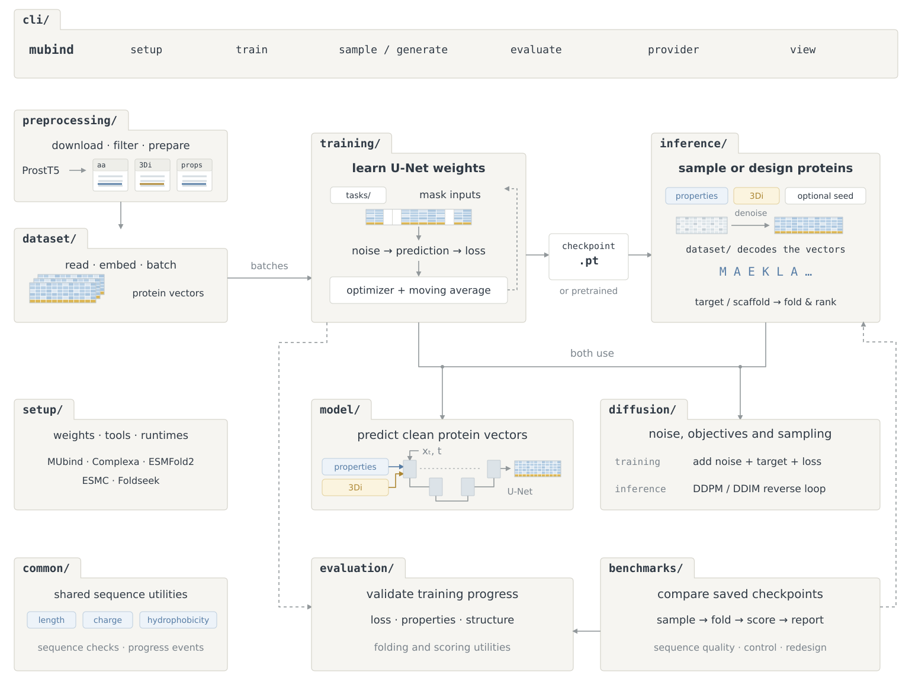

# MUbind

MUbind prepares protein data, trains a conditioned diffusion model, and uses trained or downloaded checkpoints to generate and evaluate designs.



## Structure

```text
mubind/
├── __main__.py        CLI entry point that starts the instant spinner before heavy imports
├── paths.py           Default artifacts/ directory paths and moved-artifact lookup
├── resources.py       Unpacks tracked benchmark, validation, and example reference bundles
├── examples.py        Copies bundled example target PDBs and loads preset target options
├── runtime.py         Resolves verified Python interpreters and weight paths for external workers
├── common/            Shared sequence normalization, biochemical property math, and progress events
├── cli/               Typer commands, Questionary/Rich menus, live progress UIs, and 3D viewer
├── setup/             Downloads weights, installs Foldseek, and builds isolated uv model runtimes
├── preprocessing/     Downloads ProstT5 Parquet shards, filters lengths, and writes .npy arrays
├── dataset/           Memory-mapped ProstT5 dataset loader, 8-channel embedding, and canvas decoding
├── model/             ProteinDiffusionUNet backbone, 3Di/property conditioning pyramids, and 1D layers
├── diffusion/         1,000-step noise schedule, pred_x0 MSE losses, and DDPM/DDIM reverse sampling
├── training/          Training loop, single-step loss, task/mask collators, EMA, and checkpointing
├── evaluation/        In-training validation loss, generation panels, and monomer structure recovery
├── inference/         Shared predict() entry point, direct sampling, 5-stage binder design, and workers
└── benchmarks/        Post-training paper benchmark suites, ESMFold2/ESMC scoring, and report generation
```

## How it fits together

1. **Command-line interface and setup (`cli/`, `setup/`, `runtime.py`).** `cli/app.py` routes `mubind` subcommands (`setup`, `train`, `generate`, `sample`, `evaluate`, `provider`, and `view`) to interactive terminal screens or unattended workflows without importing PyTorch at startup. `setup/` prepares the default `prostt5-300k.pt` checkpoint, Foldseek, and isolated `uv` virtual environments for Complexa and ESMFold2 under `artifacts/models/.mubind/`, while `runtime.py` resolves those verified worker interpreters at runtime.
2. **Data preparation and representation (`common/`, `preprocessing/`, `dataset/`).** `preprocessing/prostt5/` downloads `Rostlab/ProstT5Dataset`, filters sequences to 50 to 70 residues without truncation, computes length, net charge, and mean hydrophobicity via `common/properties.py`, and writes memory-mapped `aa.npy`, `threedi.npy`, and `properties.npy` splits. `dataset/` opens those arrays lazily (`ProstT5Dataset`), embeds each residue into 6 amino acid/padding channels plus 2 Foldseek 3Di coordinates (`[8, L]` in `embed.py`), and decodes denoised canvases back into sequences and 3Di strings (`decode.py`).
3. **Diffusion model and math (`model/`, `diffusion/`).** `model/` defines `ProteinDiffusionUNet`, a 3-level 1D U-Net (`70 -> 35 -> 17`) conditioned on diffusion timestep, multiscale property maps (`PropertyConditioningEncoder`), contextualized 3Di structure maps and cross-attention (`ThreeDiConditioningEncoder`), and fixed seed residues. `diffusion/` pairs the U-Net with a 1,000-step cosine noise schedule (`schedule.py`), `pred_x0` targets and residue/PAD-balanced MSE loss (`objective.py`), and reverse sampling (`sampling.py`) via 1,000-step stochastic DDPM (`ddpm.py`) or fast deterministic DDIM (`ddim.py`).
4. **Training and in-training validation (`training/`, `evaluation/`).** `training/tasks/` turns clean dataset rows into fill-in-the-blank inpainting or full-redesign tasks and masks subsets of 3Di tokens and properties. `training/step.py` adds noise, runs optional self-conditioning, and computes the reconstruction loss, while `training/trainer.py` updates weights, maintains `ModelEMA`, saves atomic checkpoints, and calls `evaluation/` to track validation loss, property error, and ESMFold2 monomer structure recovery on the 10-protein validation panel.
5. **Generation, binder design, and benchmarks (`inference/`, `benchmarks/`).** `inference/predict.py` is the shared reverse-sampling and decoding entry point. `inference/generate.py` (`mubind sample`) samples sequences directly from a checkpoint with DDIM. `inference/design.py` (`mubind generate`) runs the 5-stage target-directed minibinder pipeline across `inference/helpers/` and `inference/services/`, coordinating Complexa scaffold generation, ESMFold2 scaffold ranking, Foldseek 3Di encoding, `StructuralGuidance` DDPM redesign, and final complex ranking. `benchmarks/` (`mubind evaluate`) runs the five paper evaluation protocols (`unconditional`, `properties`, `structure`, `full-design`, and `inpainting`) and writes summary tables and plots.

