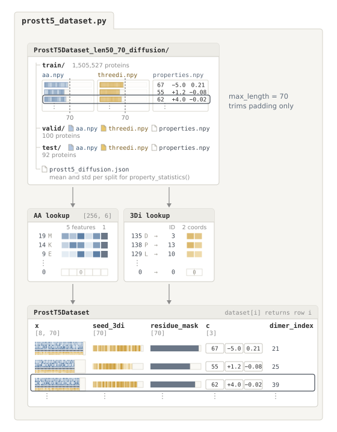
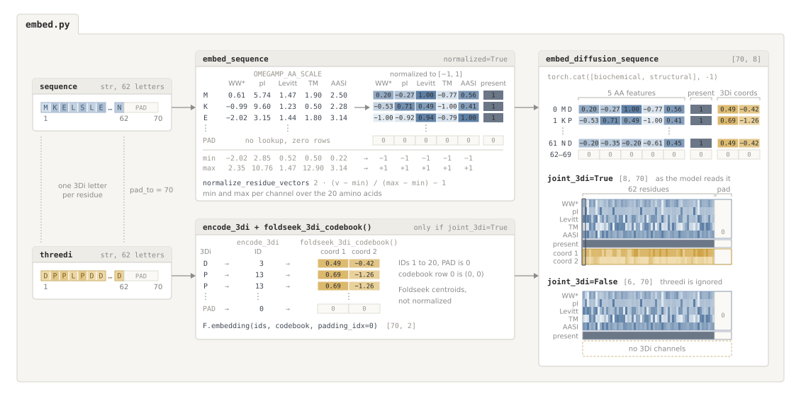
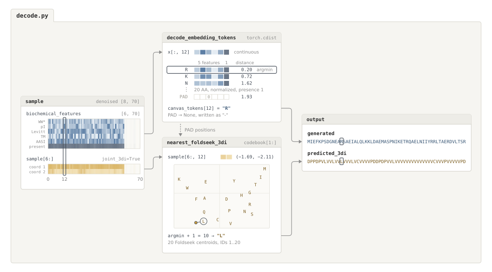

# Dataset

This folder loads the prepared memory-mapped ProstT5 arrays (`aa.npy`, `threedi.npy`, and `properties.npy`) into PyTorch batches and converts between sequence strings and the continuous 8-channel vectors used by the diffusion model.



## Structure

```text
dataset/
├── prostt5_dataset.py   Memory-mapped PyTorch Dataset and DataLoader helper for aa.npy, threedi.npy, and properties.npy
├── embed.py             Embeds amino acid sequences and 3Di tokens into continuous tensors
└── decode.py            Decodes continuous diffusion outputs back into amino acid and 3Di strings
```

## How data flows

1. **`prostt5_dataset.py`** (`ProstT5Dataset` and `make_dataloader`) opens `aa.npy`, `threedi.npy`, and `properties.npy` in memory-mapped read mode so loading a split uses almost no RAM. When a batch of row indices is requested, it slices only those rows, trims trailing padding down to `max_length` (`70` by default), looks up the continuous residue and 3Di embeddings, and returns a dictionary per protein
   - `x` of shape `[8, L]` combining 5 normalized amino acid features, 1 residue-present channel (`1` for residues, `0` for padding), and 2 Foldseek 3Di coordinates
   - `seed_3di` of shape `[L]` with integer 3Di token IDs (`1..20`, `0` for padding)
   - `c` of shape `[3]` with raw `[length, charge, hydrophobicity]`
   - `residue_mask` of shape `[L]` marking non-padding positions
   - `dataset_index` with the integer row index
2. **`embed.py`** defines the 5-feature OmegAMP amino acid scale (`[WW*, pI, Levitt, TM, AASI]`), min-max normalization to `[-1, 1]`, and 3Di token and coordinate embedding (while whole-protein property math lives in `common/properties.py`).

   

3. **`decode.py`** maps denoised `[8, L]` model outputs back to the nearest amino acid (or `PAD`) by Euclidean distance on the first 6 channels and to the nearest 3Di letter on the last 2 channels, and checks that decoded residues form a single contiguous sequence without internal padding.

   

## Usage

```python
from mubind.dataset import ProstT5Dataset, make_dataloader

dataset = ProstT5Dataset(
    "artifacts/datasets/ProstT5Dataset_len50_70_diffusion",
    split="train",
    max_length=70,
    normalize_embeddings=True,
    joint_3di=True,
)
loader = make_dataloader(dataset, batch_size=64)
batch = next(iter(loader))
```
