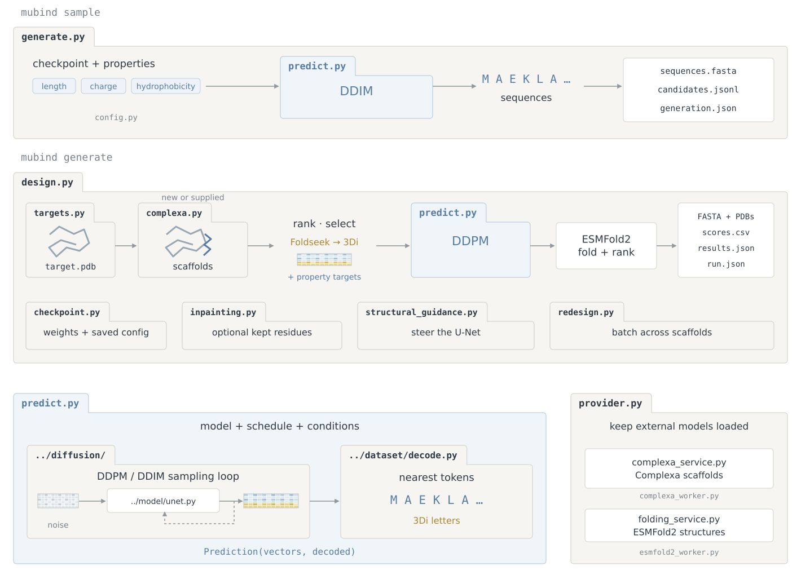

# Inference

Runs reverse diffusion sampling (`predict.py`), direct sequence generation (`generate.py`), and target-directed minibinder design (`design.py`).

```text
inference/
├── predict.py                 Runs reverse diffusion and decodes output sequences
├── generate.py                Samples sequences from a checkpoint (mubind sample)
├── design.py                  Designs minibinders for a target PDB (mubind generate)
├── config.py                  GenerationConfig and DesignConfig settings
├── helpers/
│   ├── checkpoint.py          Loads MUbind and legacy checkpoints
│   ├── structural_guidance.py Steers sampling toward a target 3Di structure
│   ├── inpainting.py          Masks fixed binder residues and checks outputs
│   ├── targets.py             Parses target PDBs and extracts chains
│   ├── scaffolds.py           Ranks Complexa scaffolds and encodes Foldseek 3Di
│   └── redesign.py            Batches guided redesign and folds candidate complexes
└── services/                  Persistent Complexa and ESMFold2 workers (see services/README.md)
```


