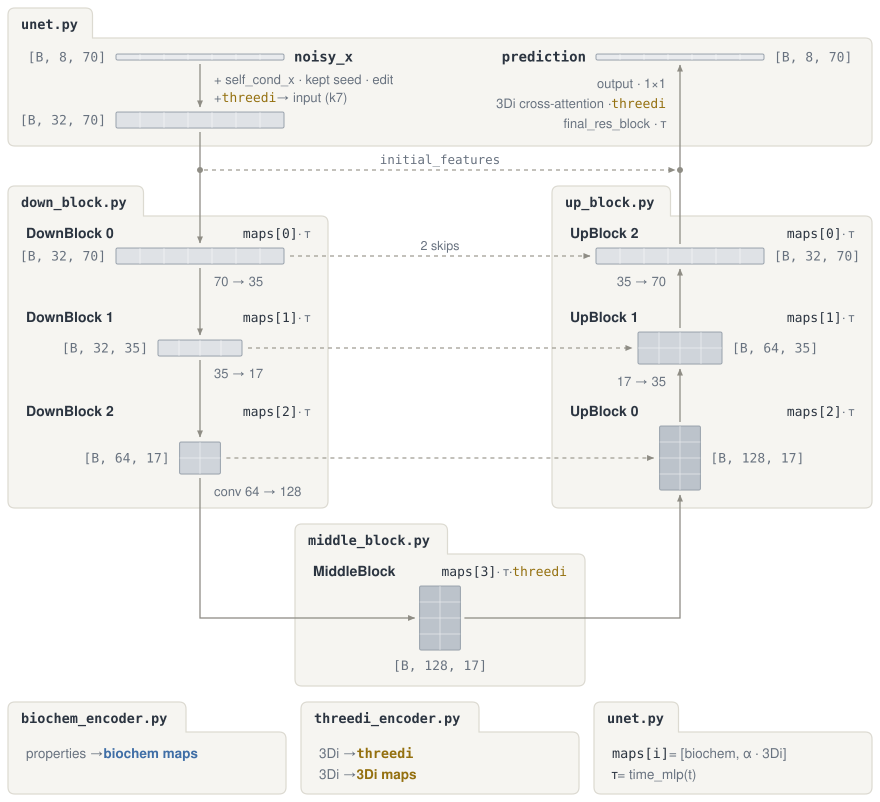

# Model

Defines `ProteinDiffusionUNet`, the 1D U-Net that predicts clean protein embeddings from noisy residues, 3Di structure tokens, and biochemical properties.

```text
model/
├── unet.py                          Top-level ProteinDiffusionUNet and forward pass
├── config.py                        Configuration dataclasses for the backbone, 3Di, and properties
├── inputs.py                        Input containers (StructureInput, PropertyInput, SeedInput)
├── conditioning/                    Encodes 3Di structure and global properties
│   ├── biochem_encoder.py           PropertyConditioningEncoder, standardization, and masking
│   ├── threedi_encoder.py           ThreeDiConditioningEncoder with optional context and per-level maps
│   ├── threedi_2d_representation.py FoldseekThreeDiEmbedding and fixed 2D centroid codebook
│   └── _pyramid.py                  Shared conditioning pyramid builder
├── blocks/                          The three U-Net stages
│   ├── down_block.py                DownBlocks, DownBlock, and SkipFeatures
│   ├── middle_block.py              MiddleBlock at the shortest sequence length
│   └── up_block.py                  UpBlocks and UpBlock
└── layers/                          Shared 1D convolution, normalization, time, and attention primitives
    └── cross_attention.py          ThreeDiCrossAttention1d over the full-length 3Di embedding
```


