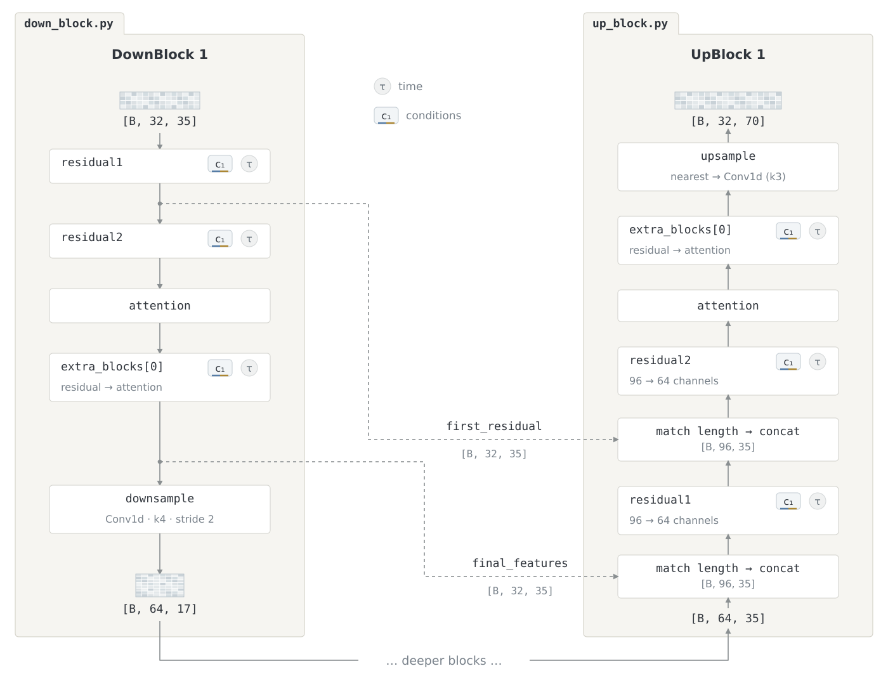

# Blocks

Runs the U-Net encoder, bottleneck, and decoder using time and per-level conditioning.

```text
blocks/
├── down_block.py   Processes features, saves SkipFeatures, and downsamples
├── middle_block.py Processes the bottleneck with optional structural cross-attention
└── up_block.py     Merges encoder skips, processes features, and upsamples
```


