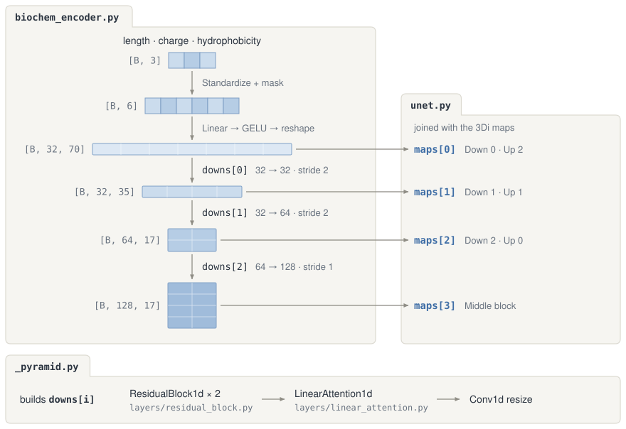
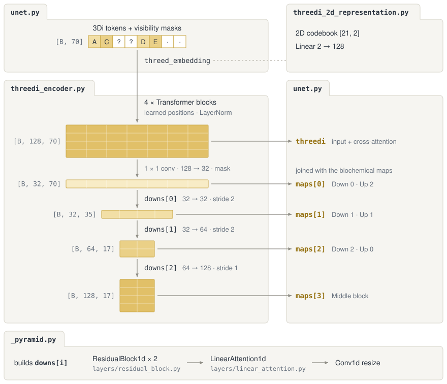

# Conditioning

Encodes global properties and 3Di structure for `ProteinDiffusionUNet`; the 3Di encoder returns the full-length contextual embedding and optional per-level maps.

```text
conditioning/
├── biochem_encoder.py           Standardizes and masks properties, then builds per-level feature maps
├── threedi_encoder.py           Owns ContextualThreeDiEncoder and builds optional per-level maps
├── threedi_2d_representation.py Fixed Foldseek 2D codebook and learned projection
└── _pyramid.py                  Shared pyramid builder for property and 3Di feature maps
```




