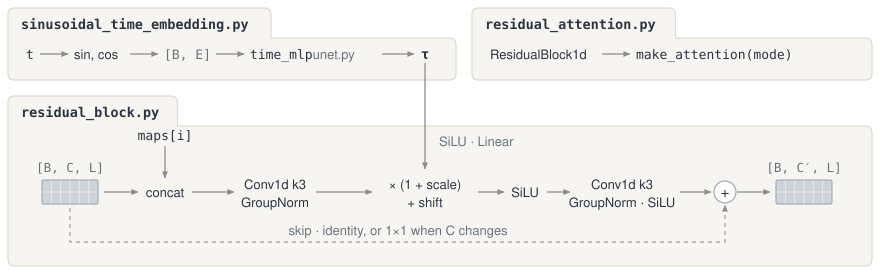
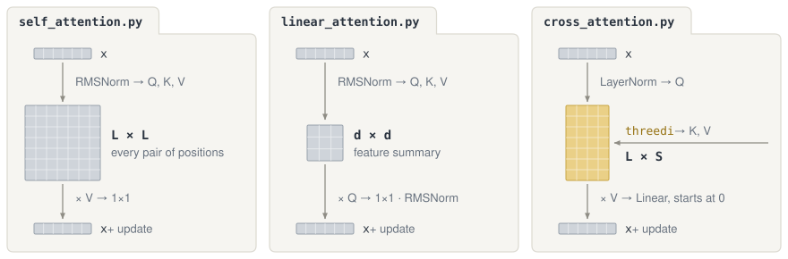

# Layers

Shared 1D building blocks used across the U-Net stages (`../blocks/`) and the conditioning pyramids (`../conditioning/`). Every layer operates on sequence tensors shaped `[B, C, L]` (batch, channels, sequence length).

## Core idea

A 1D convolution with `kernel_size=3` only sees three neighboring amino acids at a time (`i-1, i, i+1`), which captures local backbone geometry like helices and turns but is blind to the rest of the peptide. Attention lets every position look across the entire sequence at once so distant residues that fold together in 3D space stay consistent.

Every U-Net stage (`DownBlock`, `MiddleBlock`, `UpBlock`) and both conditioning pyramids (`PropertyConditioningEncoder`, `ThreeDiConditioningEncoder`) are built by repeating that two-step rhythm, first a **local 3-residue convolution (`ResidualBlock1d`)** to mix neighbors and inject conditioning, then **sequence-wide attention** to share information across the whole peptide.

```text
layers/
├── residual_block.py            ResidualBlock1d (local kernel-3 conv + spatial and timestep conditioning)
├── sinusoidal_time_embedding.py SinusoidalTimeEmbedding for the scalar diffusion timestep
├── residual_attention.py        ResidualAttentionBlock (one ResidualBlock1d followed by attention)
├── attention.py                 make_attention (selects none, linear, or full attention per block)
├── self_attention.py            SelfAttention1d (exact O(L²) pairwise attention for short sequences)
├── linear_attention.py          LinearAttention1d (fast O(L) attention for longer sequences)
├── cross_attention.py           ThreeDiCrossAttention1d (queries the full-length 70-token 3Di sequence)
├── rms_norm.py                  RMSNorm1d (channel normalization around attention layers)
└── utils.py                     Sequence-length alignment, mask resizing, and GroupNorm helpers
```

## 1. Local convolution and conditioning (`residual_block.py`, `sinusoidal_time_embedding.py`, `residual_attention.py`)



`ResidualBlock1d` runs two `Conv1d(k=3) -> GroupNorm -> SiLU` layers over neighboring residues and adds the original input back through a skip connection (using a `1×1` conv if the number of channels changed).

Because the U-Net needs to know both **what structure/properties to aim for at each residue** and **how noisy the current diffusion step is**, `ResidualBlock1d` accepts two distinct conditioning inputs that match the shape of those two signals

- **Per-position spatial conditioning (`maps[i]`)** varies along the sequence (for example, residue 5 might sit in a helix while residue 20 is in a loop, or an encoder skip connection in `UpBlock` carries fine-grained features for each position). It is concatenated directly onto the input channels before the first convolution so the kernel sees the features and their local conditioning together.
- **Whole-peptide timestep conditioning (`τ`)** is a single vector for the entire sequence that tells the block which diffusion step `t` it is denoising (`SinusoidalTimeEmbedding` turns `t` into `sin`/`cos` frequencies, and `time_mlp` in `unet.py` projects it to `τ`). Inside `ResidualBlock1d`, a linear layer turns `τ` into a per-channel `scale` and `shift` applied after the first convolution (`h = h * (1 + scale) + shift`), modulating every position uniformly.

When `PropertyConditioningEncoder` and `ThreeDiConditioningEncoder` build their pyramids in `../conditioning/`, there is no diffusion timestep or external map yet, so they use the exact same `ResidualBlock1d` with both conditioning inputs omitted.

When a U-Net level is configured with extra depth (`blocks_per_level > 2`), it stacks `ResidualAttentionBlock` modules (`residual_attention.py`), each wrapping one `ResidualBlock1d` followed immediately by an attention layer.

## 2. Sequence attention (`self_attention.py`, `linear_attention.py`, `cross_attention.py`, `attention.py`)



MUbind uses three attention layers depending on the sequence length and whether the features are attending to themselves or to the 3Di structure

- **`SelfAttention1d` (`O(L²)` full pairwise attention)** compares every residue position directly against every other position (`L × L` softmax matrix). Because quadratic cost is expensive at full length (`70 × 70`) but tiny at the bottleneck (`17 × 17`), standard training runs full self-attention at `MiddleBlock` (`L = 17`) where global all-to-all routing matters most.
- **`LinearAttention1d` (`O(L)` summarized attention)** avoids building an `L × L` matrix by applying softmax over keys and queries separately and summarizing the sequence into a compact `d × d` context matrix before multiplying by the queries. That makes it fast enough to run at every resolution (`L = 70, 35, 17`) inside `DownBlock`, `UpBlock`, and both conditioning pyramids. In the 3Di pyramid it also takes an `availability_mask` so padded or hidden `?` tokens are excluded from keys/values and zeroed in the output.
- **`ThreeDiCrossAttention1d` (`O(L × 70)` structural lookup)** lets the U-Net's sequence features (`queries`) attend directly to the full-length 70-token contextual 3Di sequence (`keys` and `values`), rather than relying only on the downsampled pyramid maps. It runs right after `final_res_block` at full resolution (and optionally inside `MiddleBlock`). Its output projection is initialized to zero so the layer starts as an exact no-op and gradually learns to pull in structural detail during training.

`make_attention` (`attention.py`) chooses which self-attention variant a block gets based on `backbone.attention_mode` (default `"unet_linear"`).

| `attention_mode` | `DownBlock` and `UpBlock` (`L = 70, 35, 17`) | `MiddleBlock` bottleneck (`L = 17`) |
| --- | --- | --- |
| `"none"` | `Identity` (no attention) | `Identity` (no attention) |
| `"bottleneck"` | `Identity` (no attention) | `SelfAttention1d` (full `O(L²)`) |
| `"unet_linear"` (default) | `LinearAttention1d` (`O(L)`) | `SelfAttention1d` (full `O(L²)`) |
| `"unet_full"` | `SelfAttention1d` (full `O(L²)`) | `SelfAttention1d` (full `O(L²)`) |

## 3. Normalization and sequence-length helpers (`rms_norm.py`, `utils.py`)

- **`RMSNorm1d`** normalizes each residue's channel vector by its root-mean-square and multiplies by a learned per-channel weight. It wraps the inputs (and in linear attention, the output) of the attention layers to keep activations well-scaled.
- **`_match_length`** fixes off-by-one sequence lengths caused by odd dimensions during stride-2 downsampling and upsampling. When length `70` steps down twice (`70 -> 35 -> 17`) and then doubles on the way back up (`17 -> 34`), `_match_length` zero-pads `34` back to `35` so it can be concatenated with the `[B, C, 35]` skip connection from `DownBlock 1`.
- **`_resize_availability_mask`** shrinks the `[B, 70]` boolean 3Di mask down to `[B, 35]` and `[B, 17]` using nearest-neighbor interpolation as `ThreeDiConditioningEncoder` steps down its pyramid.
- **`_group_count`** picks the largest `GroupNorm` group count from `(8, 4, 2, 1)` that evenly divides a block's channel width.
