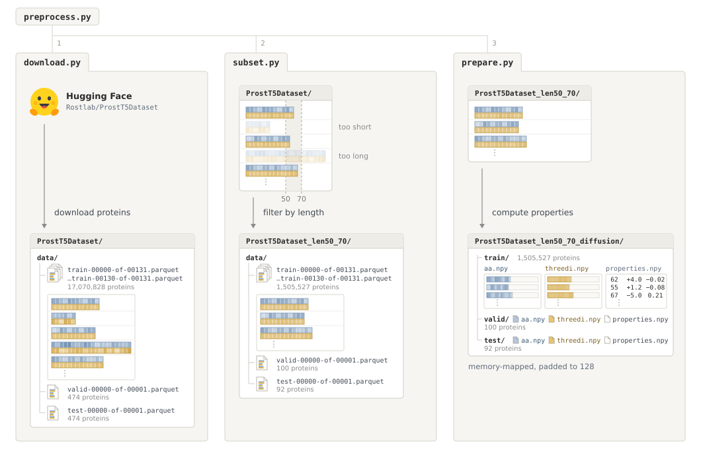

# Preprocessing

This folder downloads the raw ProstT5 dataset from Hugging Face, filters sequences by length, and converts the kept proteins into memory-mapped `.npy` arrays for diffusion training.



## Structure

```text
preprocessing/
└── prostt5/
    ├── preprocess.py        Runs the three steps in order and skips finished stages
    └── steps/
        ├── download.py      Downloads raw Parquet shards from Rostlab/ProstT5Dataset
        ├── subset.py        Filters Parquet shards to sequences within the length bounds
        ├── prepare.py       Computes properties and writes padded memory-mapped .npy arrays
        ├── validate.py      Checks whether raw, filtered, or prepared folders on disk are complete
        └── _io.py           Shared Parquet and manifest helpers
```

## Pipeline stages

`preprocess.py` coordinates the three steps inside `steps/` and stages in-progress work under a hidden `.mubind/` directory before moving finished folders into place.

1. **`download.py`** fetches the pinned `Rostlab/ProstT5Dataset` release from Hugging Face into `ProstT5Dataset/`. On disk, `data/` holds 131 training Parquet shards (`train-00000-of-00131.parquet` through `train-00130-of-00131.parquet`) plus one shard each for `valid` and `test`. Each row stores a protein's amino acid sequence and 3Di structure tokens together in the same table.
2. **`subset.py`** streams those Parquet shards and keeps only proteins within the target length range (`50` to `70` residues by default) without truncating sequences, writing matching Parquet shards into `ProstT5Dataset_len50_70/data/`.
3. **`prepare.py`** merges the filtered shards for each split (`train/`, `valid/`, `test/`), computes the three global conditioning properties (length, net charge, and mean hydrophobicity) along with split normalization statistics, and writes three separate memory-mapped arrays padded to length 128 inside each split folder (`aa.npy`, `threedi.npy`, and `properties.npy`) alongside `prostt5_diffusion.json`.

## Usage

Run the full restartable pipeline from Python

```python
from mubind.preprocessing.prostt5.preprocess import prepare_prostt5

prepare_prostt5("artifacts/datasets", min_length=50, max_length=70)
```

Or run the three steps individually from the command line

```bash
python -m mubind.preprocessing.prostt5.steps.download \
  --out artifacts/datasets/ProstT5Dataset

python -m mubind.preprocessing.prostt5.steps.subset \
  --source artifacts/datasets/ProstT5Dataset \
  --out artifacts/datasets/ProstT5Dataset_len50_70 \
  --min-length 50 --max-length 70

python -m mubind.preprocessing.prostt5.steps.prepare \
  --source artifacts/datasets/ProstT5Dataset_len50_70 \
  --out artifacts/datasets/ProstT5Dataset_len50_70_diffusion
```
