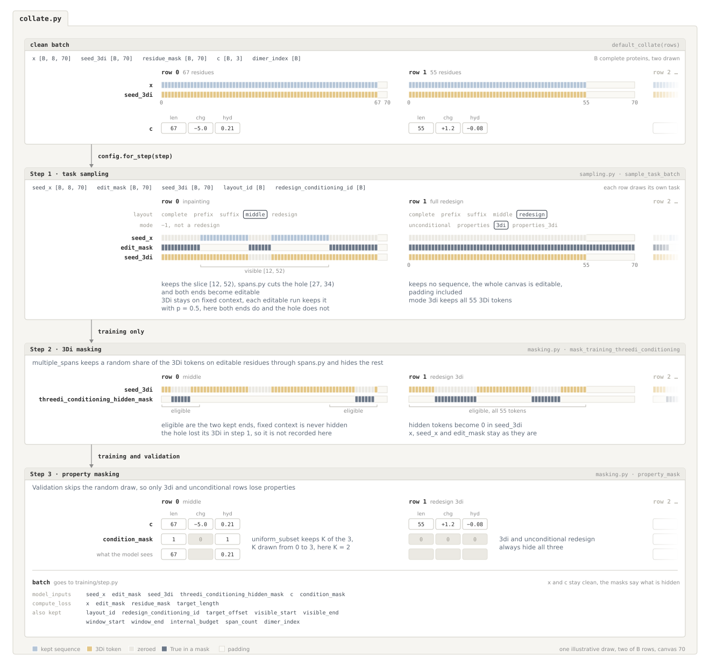
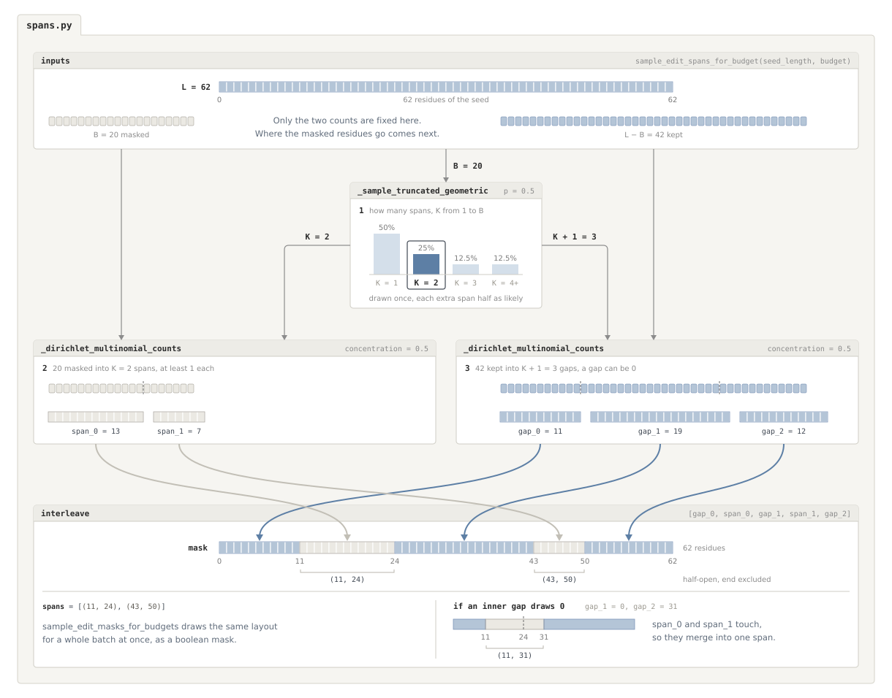

# Training Tasks

This folder sits between `ProstT5Dataset` and the diffusion step. It turns complete proteins into fill-in-the-blank tasks by choosing which residues the model sees, which it must generate, and which structure and property hints it receives.

## Structure

```text
training/tasks/
├── collate.py         Stacks proteins into a batch and runs the steps below
├── sampling.py        Chooses each task and builds its sequence and structure inputs
├── masking.py         Hides some of the remaining structure and property hints
├── spans.py           Groups selected positions into contiguous spans
└── config.py          Controls task probabilities, training stages, and masking
```

## How `TaskCollator` prepares a batch

Start with `TaskCollator` in `collate.py`. It accepts a list of clean dataset rows and runs three steps in order.

1. **Stack the proteins and choose their tasks.** `collate_task_rows` stacks the rows with `default_collate`, then calls `sample_task_batch` in `sampling.py`. The training step selects the active task probabilities through `config.for_step(step)`.
2. **Optionally hide more structure hints during training.** `mask_training_threedi_conditioning` in `masking.py` blanks out some remaining 3Di tokens on editable residues. This teaches the model to work with partial structure. Tokens on fixed sequence context stay visible.
3. **Choose which properties are visible.** `property_mask` in `masking.py` builds `condition_mask` for length, charge, and hydrophobicity. It can hide random subsets during training. Unconditional and 3Di-only redesign tasks always have all properties hidden.

All three steps share the supplied random generator. Validation skips the extra random masking in steps 2 and 3, while still following the sampled task's rules. The clean targets `x` and property values `c` are preserved.



In the figure, row 0 draws `middle`, keeps the slice `[12, 52)` and loses the hole `[27, 34)`, while row 1 draws a `3di` redesign with no sequence. Step 2 only hides 3Di on editable residues that still carry it, and step 3 hides every property on the 3Di-only row.

## The four steps inside `sampling.py`

Both sampling implementations follow the same sequence, with a named helper for each step.

1. **Choose a layout and redesign mode.** The layouts are `complete`, `prefix`, `suffix`, `middle`, and `redesign`. Redesign additionally chooses `unconditional`, `properties`, `3di`, or `properties_3di`.
2. **Choose the initially visible region.** `complete` starts with the whole protein; `prefix`, `suffix`, and `middle` start with the corresponding slice. `redesign` starts with no visible sequence. The per-row version also chooses the protein's canvas offset and terminal padding.
3. **Cut out sequence edit spans.** `spans.py` chooses internal holes in that region. Their features are zeroed in `seed_x`, and `edit_mask` marks them and any editable ends. Even `complete` contains internal edits. Redesign has an empty `seed_x` and makes the whole canvas editable.
4. **Choose the initial structure hints.** Fixed context keeps its 3Di tokens. Each contiguous editable run can also retain its tokens, according to `editable_3di_retention_probability`. Redesign keeps structure only in its two 3Di modes.

The main functions come first in the file, followed by the per-row helpers and then the batched helpers. Training normally uses `_batched_aligned_mixed_batch`, which processes all proteins together. It requires `batched_mixed=True`, no terminal padding, and no random canvas offsets. Otherwise `sample_task_batch` uses the per-row loop, which is also used by validation and evaluation. The two versions preserve task distributions but draw random numbers in different orders, so the same seed need not produce the same examples across versions.

## How `spans.py` builds edit regions

For a region of length `L` and an edit budget of `B` residues, the sampler chooses a span count `K`, divides the budget among those spans, and divides the remaining residues among the `K + 1` surrounding gaps. A geometric distribution favors fewer spans, and Dirichlet-multinomial draws choose their lengths and the gap lengths.



In the figure, 20 edits in a 62-residue region become spans of 13 and 7 residues, separated by gaps of 11, 19, and 12 residues. Alternating gaps and spans gives `[11, 24)` and `[43, 50)`, with each end excluded. If the gap between two spans is zero, they merge.

`sample_edit_spans_for_budget` returns intervals for one protein; `sample_edit_masks_for_budgets` returns boolean masks for a batch. Sequence sampling uses these positions as edit holes. Multiple-span structure masking uses the same algorithm to select tokens to **keep**, then hides the rest.

## Configuration (`config.py`)

- **`TaskConfig`** controls layouts, visible regions, edit spans, canvas placement, and initial structure retention. **`TaskStageConfig`** changes task probabilities as training progresses.
- **`ThreeDiMaskingConfig`** controls the optional extra structure hiding during training, using `single_span` or `multiple_spans`.
- **`PropertyDropoutConfig`** controls random property hiding, using `uniform_subset` or `independent`.

The current training defaults use `DEFAULT_TASK_STAGES`. They train on 3Di redesign through step 150,000, mix all redesign modes through step 200,000, then use the configured mixture of all layouts.

## Usage

Use the current training defaults and pass a list of dataset rows as `rows`.

```python
import torch
from mubind.training.config import TrainingConfig
from mubind.training.tasks import TaskCollator

config = TrainingConfig()
collator = TaskCollator(
    config=config.tasks,
    batched_mixed=config.batched_tasks,
    training_threedi_masking=config.threedi_masking,
    property_dropout=config.property_dropout,
    training=True,
)

batch = collator.collate(
    rows,
    generator=torch.Generator().manual_seed(42),
    step=100_000,
)
```
